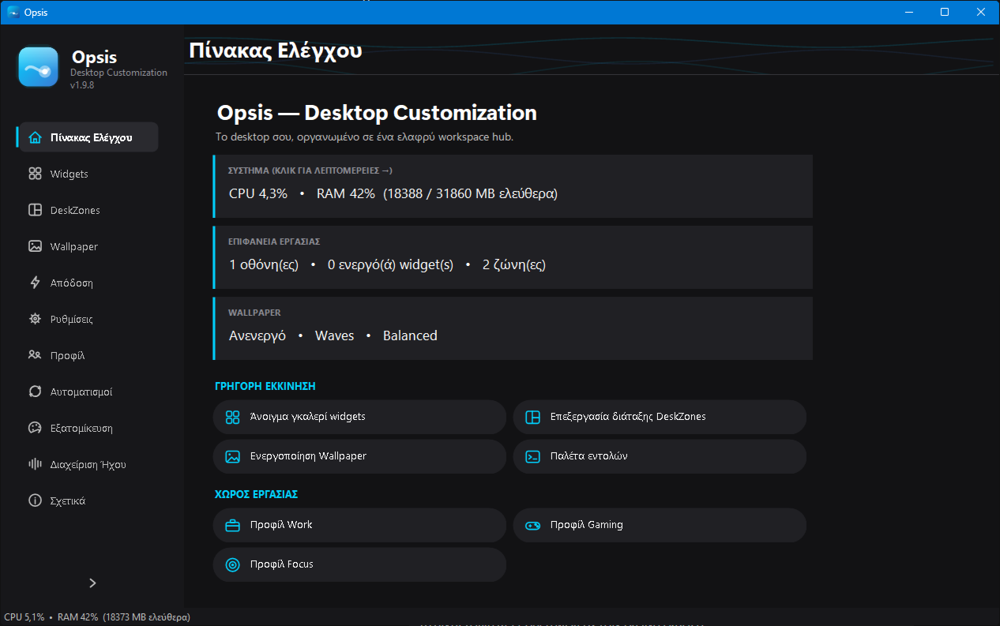
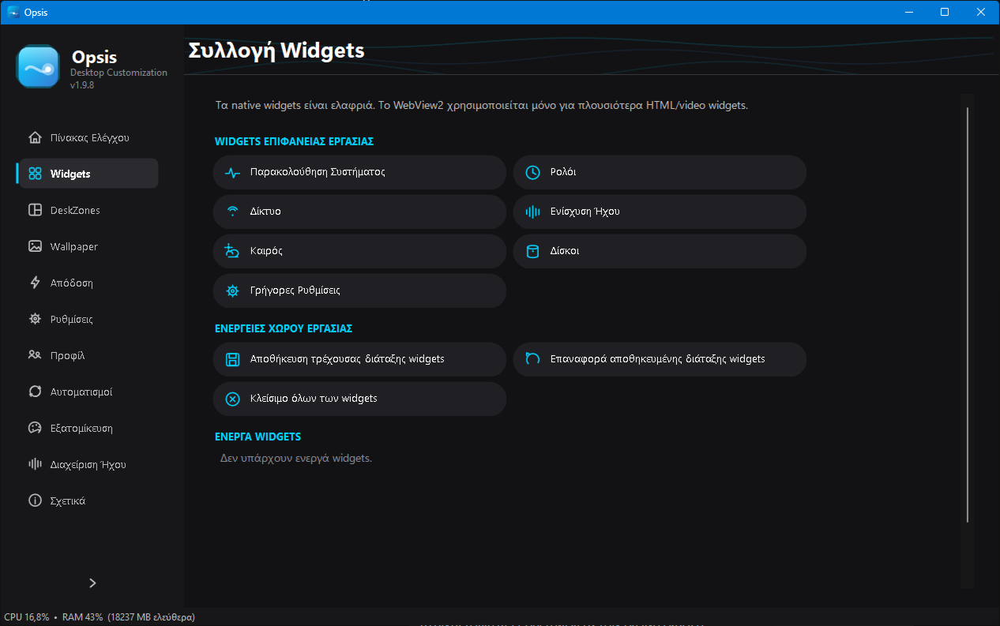
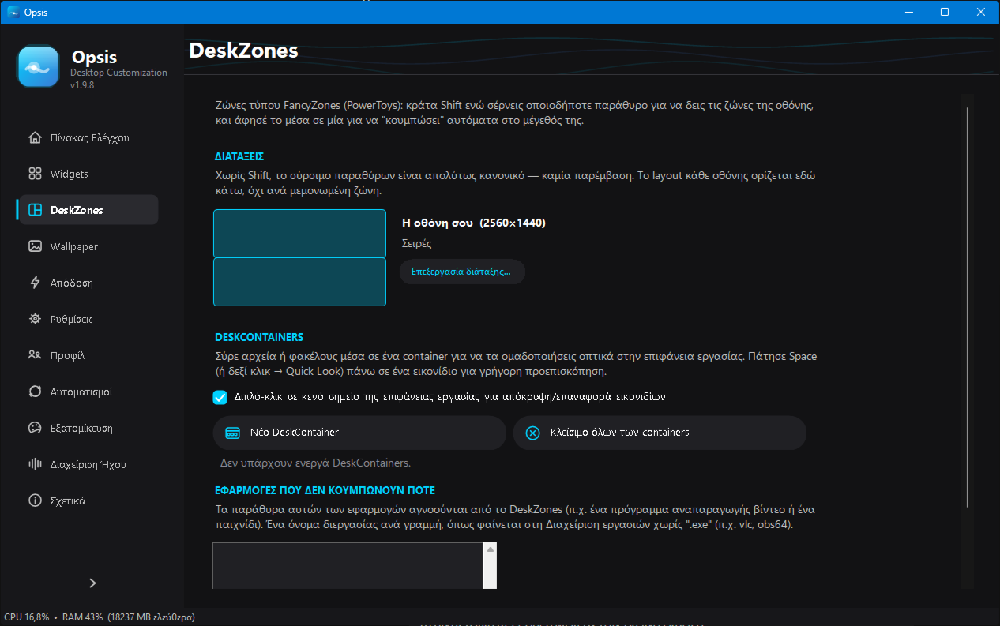
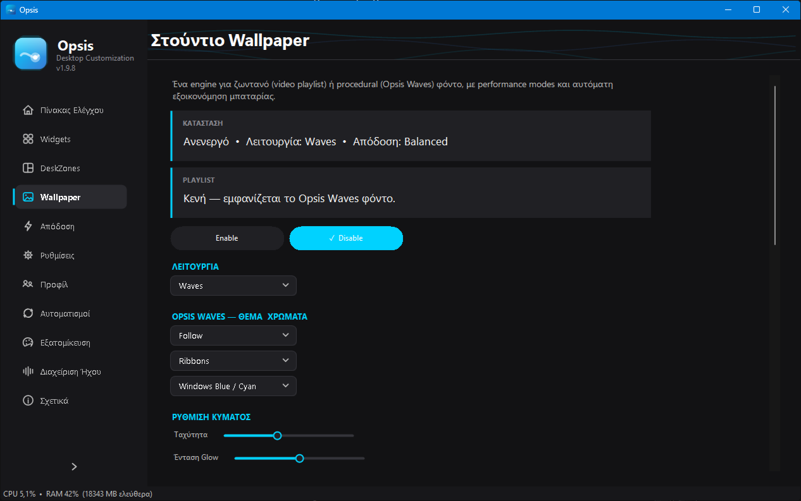
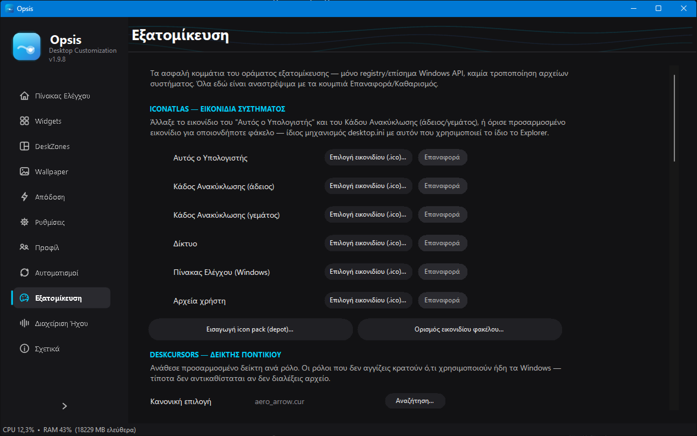
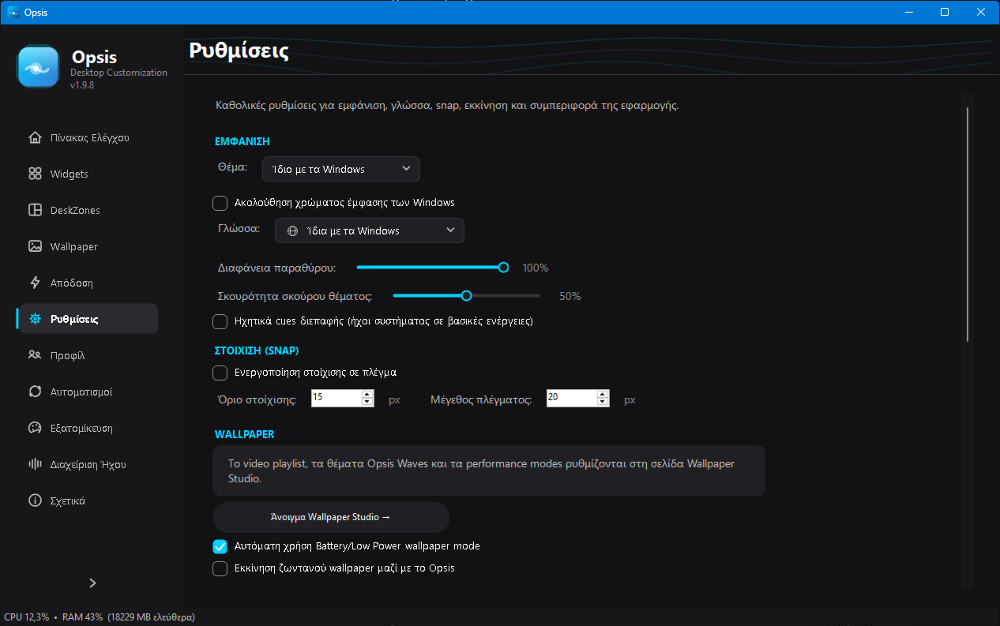
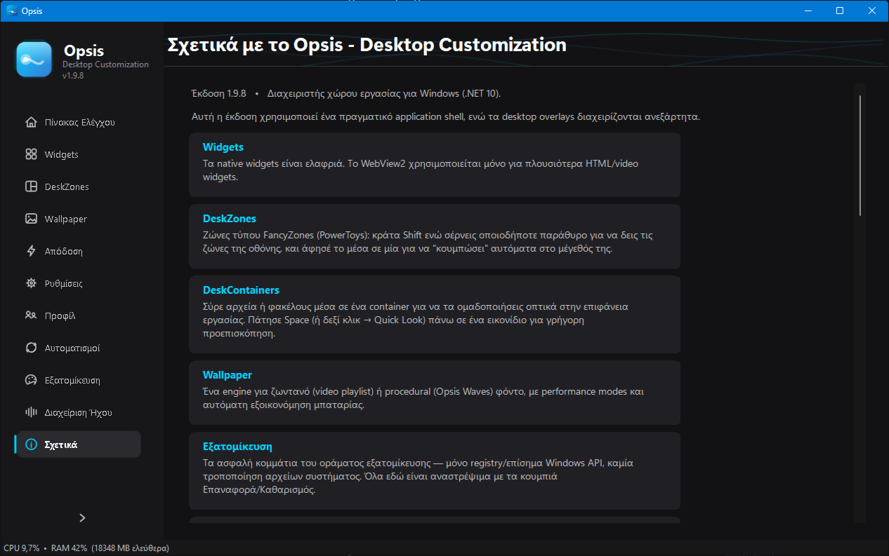

# Opsis — Desktop Customization

<p align="center">
  
</p>

<p align="center">
  <strong>Το desktop σου, οργανωμένο σε ένα ελαφρύ workspace hub.</strong><br/>
  <strong>Your desktop, organized into a lightweight workspace hub.</strong>
</p>

<p align="center">
  
  
  
  
  
</p>

*A free, native Windows desktop-customization suite — see the [English section](#english) below.*

## Περιεχόμενα / Contents

- [Ελληνικά](#ελληνικά)
- [English](#english)
- [Άδεια / License](#άδεια--license)

## Ελληνικά

**Opsis** (πρώην *MotionDesk Studio*) είναι μια native εφαρμογή WinForms για Windows 10/11 που φέρνει
σε ένα μέρος ό,τι χρειάζεται για να προσαρμόσεις και να οργανώσεις την επιφάνεια εργασίας σου: ζωντανό
wallpaper πάνω στο ίδιο το desktop (όχι ξεχωριστό παράθυρο), containers για τα εικονίδια στυλ Fences,
ζώνες στοίχισης παραθύρων στυλ FancyZones/PowerToys, native πάντα-από-πάνω widgets, ένα πραγματικό
σύστημα plugin, και δεκάδες μικρότερες λειτουργίες ποιότητας ζωής — χωρίς Electron, χωρίς περιττό
runtime.

### Λειτουργίες

| Σελίδα | Τι κάνει |
|---|---|
| 🏠 Πίνακας Ελέγχου | Ζωντανή σύνοψη συστήματος/επιφάνειας εργασίας/wallpaper, γρήγορη εκκίνηση, εναλλαγή προφίλ χώρου εργασίας |
| 🧩 Widgets | Ρολόι, Δίκτυο, Ήχος, Καιρός, Δίσκοι, Παρακολούθηση Συστήματος, Γρήγορες Ρυθμίσεις (ένταση/φωτεινότητα/σχέδιο ενέργειας), Αναπαραγωγή (media), Ειδοποιήσεις, Ημερολόγιο, Bluetooth — native, πάντα-από-πάνω, με δικό τους resize/θέμα |
| 🗂️ DeskZones | Στοίχιση παραθύρων τύπου FancyZones (πλέγμα, σειρές, στήλες, custom διατάξεις ανά οθόνη) + DeskContainers στυλ Fences για ομαδοποίηση εικονιδίων |
| 🖼️ Wallpaper | Μηχανή ζωντανού wallpaper: procedural "Opsis Waves" (θέμα-aware, wind-reactive κύματα, πραγματική βροχή σε τζάμι) ή video/playlist (.mp4, αυτόματη μετατροπή .wmv μέσω FFmpeg), ζωντανό overlay καιρού, performance modes με αυτόματη εξοικονόμηση μπαταρίας |
| ⚡ Απόδοση | CPU/RAM/GPU/δίκτυο/διεργασίες σε πραγματικό χρόνο, ειδοποιήσεις υψηλής χρήσης |
| ⚙️ Ρυθμίσεις | Θέμα (ανοιχτό/σκούρο/ακολούθηση Windows + Midnight/Forest/Dawn/High contrast), γλώσσα, στοίχιση σε πλέγμα, διαφάνεια παραθύρου, αυτόματη εκκίνηση |
| 🧑‍🤝‍🧑 Προφίλ | Αποθήκευσε/φόρτωσε πλήρη workspace profiles (Work/Gaming/Focus): ζώνες, widgets και θέμα μαζί |
| 🔁 Αυτοματισμοί | Κανόνες "όταν ξεκινήσει μια εφαρμογή → φόρτωσε ένα προφίλ", command palette και εκκινητής εφαρμογών (`Ctrl+K`) |
| 🎨 Εξατομίκευση | Custom εικονίδια συστήματος (ΙconAtlas), πακέτα θέματος `.theme`, προσαρμοσμένοι δείκτες ποντικιού, ήχοι συστήματος, **οθόνη κλειδώματος που ταιριάζει ακριβώς με το ζωντανό wallpaper** (με αυτόματο re-sync και ανίχνευση αν τα Windows το επαναφέρουν) |
| 🔊 Διαχείριση Ήχου | 5-band ζωντανός equalizer/visualizer με presets, προαιρετικό πραγματικό system-wide EQ μέσω Equalizer APO |
| ℹ️ Σχετικά | Έκδοση, ιστορικό εκδόσεων σε 14 γλώσσες, κάρτες εγκατεστημένων plugins με δικό τους ενεργό/ανενεργό διακόπτη |

Επίσης: πλήρης υποστήριξη 14 γλωσσών (Ελληνικά, Αγγλικά, Γερμανικά, Γαλλικά, Ισπανικά, Ιταλικά,
Ρωσικά, Κινέζικα, Ιαπωνικά, Πορτογαλικά, Κορεατικά, Τουρκικά, Αραβικά, Χίντι), πραγματική taskbar
διαφάνεια (τεχνική TranslucentTB, χωρίς DLL injection), αυτόματη ενημέρωση από τα GitHub releases (έλεγχος σε κάθε εκκίνηση και ανά 12 ώρες, επαλήθευση SHA-256, και η εγκατάσταση γίνεται μόνο αφού το επιβεβαιώσεις), και σύστημα plugin επεκτάσιμο μέσω
`AssemblyLoadContext` (το πρώτο, το **Opsis News Crawler**, προσθέτει μπάρα ειδήσεων/τιμών στην
επιφάνεια εργασίας· το δεύτερο, το [**Opsis Appearance**](https://github.com/giorstergiopoulos-design/OpsisAppearance), αλλάζει την εμφάνιση των ίδιων των Windows — αυτόματο Light/Dark, accent, taskbar, χρωματιστό border παραθύρων, γωνίες). Και τα δύο διατίθενται και ως αυτόνομες εφαρμογές.

### Στιγμιότυπα οθόνης / Screenshots

<table>
<tr>
<td><br/><sub>Πίνακας Ελέγχου / Dashboard</sub></td>
<td><br/><sub>Widgets</sub></td>
</tr>
<tr>
<td><br/><sub>DeskZones</sub></td>
<td><br/><sub>Wallpaper Studio</sub></td>
</tr>
<tr>
<td><br/><sub>Εξατομίκευση / Personalization</sub></td>
<td><br/><sub>Ρυθμίσεις / Settings</sub></td>
</tr>
<tr>
<td><br/><sub>Σχετικά / About</sub></td>
<td></td>
</tr>
</table>

### Εγκατάσταση

Κατεβάστε το τελευταίο `OpsisSetup.exe` από τα [Releases](../../releases/latest) και εκτελέστε το.
Κατά την εγκατάσταση μπορείτε προαιρετικά να συμπεριλάβετε το plugin **Opsis News Crawler** (ενεργό
από προεπιλογή, εύκολα απενεργοποιήσιμο). Το Opsis ελέγχει μόνο του για ενημερώσεις μία φορά τον μήνα
(ρυθμιζόμενο) — ποτέ δεν κατεβάζει ή εγκαθιστά τίποτα αυτόματα, μόνο ενημερώνει και ανοίγει τη σελίδα
της νέας έκδοσης.

Για σιωπηλή/αυτοματοποιημένη εγκατάσταση (Inno Setup):

```
OpsisSetup.exe /VERYSILENT /SUPPRESSMSGBOXES /NORESTART
```

### Χτίσιμο από τον πηγαίο κώδικα

Απαιτείται: Windows 10/11, [.NET 10 SDK](https://dotnet.microsoft.com/download), [WebView2 Runtime](https://developer.microsoft.com/microsoft-edge/webview2/) (συνήθως ήδη εγκατεστημένο).

```bash
dotnet build MotionDeskStudio.csproj -c Release
dotnet publish MotionDeskStudio.csproj -c Release -r win-x64 --self-contained false
ISCC.exe installer.iss
```

Το τελικό `OpsisSetup.exe` καταλήγει στο `Output\`. Εναλλακτικά, `dotnet run --project
MotionDeskStudio.csproj` ή `RunLatest.bat` για απευθείας εκτέλεση.

### Δομή αποθετηρίου

```
src/
  Services/     Οριζόντιες υπηρεσίες (ρυθμίσεις, διαδρομές, ενημερώσεις, plugin host, device interop)
  UI/           Κύριο παράθυρο, σελίδες, themed controls
  Widgets/      Μηχανή wallpaper, DeskZones, DeskContainers, native widgets, tray
locales/        14 αρχεία JSON γλωσσών
assets/         Εικονίδια
screenshots/    Στιγμιότυπα για αυτό το README
installer.iss   Script Inno Setup
```

## English

**Opsis** (formerly *MotionDesk Studio*) is a native WinForms desktop-customization suite for
Windows 10/11. It renders live wallpapers directly on the desktop (WorkerW/Progman injection, the
same technique behind tools like Lively Wallpaper), gives you Fences-style icon containers,
FancyZones-style window snapping, native always-on-top widgets, a real plugin system, and
system-wide quality-of-life tooling — all as a single lightweight app with no browser runtime
bundled in.

### Features

| Page | What it does |
|---|---|
| 🏠 Dashboard | Live system/desktop/wallpaper summary, quick launch, workspace profile switching |
| 🧩 Widgets | Clock, Network, Audio, Weather, Disk, System Monitor, Quick Settings (volume/brightness/power plan), Now Playing, Notifications, Calendar, Bluetooth — native, always-on-top, each with its own resize/theme |
| 🗂️ DeskZones | FancyZones-style window snapping (grid, rows, columns, per-monitor custom layouts) + Fences-style DeskContainers for icon grouping |
| 🖼️ Wallpaper | Live wallpaper engine: procedural "Opsis Waves" (theme-aware, wind-reactive waves, real rain-on-glass) or video/playlist (`.mp4`, `.wmv` auto-converted via FFmpeg), live weather overlay, performance modes with automatic battery saving |
| ⚡ Performance | Real-time CPU/RAM/GPU/network/process monitoring, high-usage alerts |
| ⚙️ Settings | Theme (light/dark/follow Windows + Midnight/Forest/Dawn/High contrast), language, grid snap, window opacity, startup with Windows |
| 🧑‍🤝‍🧑 Profiles | Save/load full workspace profiles (Work/Gaming/Focus): zones, widgets and theme together |
| 🔁 Automation | "When an app starts → load a profile" rules, command palette and app launcher (`Ctrl+K`) |
| 🎨 Personalization | Custom system icons (IconAtlas), `.theme` package export, custom cursors, system sounds, **a lock screen that exactly matches the live wallpaper** (auto-resynced, with drift detection if Windows resets it) |
| 🔊 Audio Enhancement | 5-band live equalizer/visualizer with presets, optional real system-wide EQ via Equalizer APO |
| ℹ️ About | Version, version history in 14 languages, installed-plugin cards with their own enable/disable switch |

Also: full support for 14 languages (English, Greek, German, French, Spanish, Italian, Russian,
Chinese, Japanese, Portuguese, Korean, Turkish, Arabic, Hindi), real taskbar translucency
(TranslucentTB technique, no DLL injection), self-update from GitHub releases (checked on every start and every 12 hours, SHA-256 verified, and installed only after you confirm), and a plugin system built on
`AssemblyLoadContext` (the first one, **Opsis News Crawler**, adds a news/market ticker bar to the
desktop; the second, [**Opsis Appearance**](https://github.com/giorstergiopoulos-design/OpsisAppearance), changes the look of Windows itself — automatic Light/Dark, accent, taskbar, coloured window borders, corners). Both are also available as stand-alone apps).

### Install

Download the latest `OpsisSetup.exe` from [Releases](../../releases/latest) and run it. During setup
you can optionally include the **Opsis News Crawler** plugin (checked by default, easy to skip).
Opsis checks for updates on its own once a month (configurable) — it never downloads or installs
anything automatically, it only notifies you and opens the new release's page.

Silent/scripted install (Inno Setup):

```
OpsisSetup.exe /VERYSILENT /SUPPRESSMSGBOXES /NORESTART
```

### Build from source

Requirements: Windows 10/11, [.NET 10 SDK](https://dotnet.microsoft.com/download), [WebView2 Runtime](https://developer.microsoft.com/microsoft-edge/webview2/) (usually already present).

```bash
dotnet build MotionDeskStudio.csproj -c Release
dotnet publish MotionDeskStudio.csproj -c Release -r win-x64 --self-contained false
ISCC.exe installer.iss
```

This produces `Output\OpsisSetup.exe`. Or run directly with `dotnet run --project
MotionDeskStudio.csproj` / `RunLatest.bat`.

### Project structure

```
src/
  Services/     Cross-cutting services (settings, paths, updates, plugin host, device interop)
  UI/           Main window, pages, themed controls
  Widgets/      Wallpaper engine, DeskZones, DeskContainers, native widgets, tray
locales/        14 language JSON files
assets/         Icons
screenshots/    Screenshots used by this README
installer.iss   Inno Setup script
```

### Plugins

Opsis loads plugins from:
1. `<Opsis install folder>\plugins\*\`
2. `%AppData%\Opsis\plugins\*\`
3. Any path registered under `HKCU\Software\Opsis\PluginPaths`

Each plugin runs in its own `AssemblyLoadContext` for dependency isolation, against a small shared
contract assembly (`OpsisNewsCrawler.Plugin.Abstractions.dll`). A plugin can contribute sidebar
pages, tray menu items and an About-page card (help, usage, version history, license), and it
inherits Opsis's live theme and language automatically. A failing plugin is logged and skipped; it
never takes the host down.

### Architecture notes

- **Desktop injection**: Opsis positions its wallpaper window between `Progman` and the desktop icon
  layer using the same WorkerW technique used by Lively Wallpaper/Wallpaper Engine, not a licensed
  component from either.
- **Zone snapping**: uses the public, documented `SetWinEventHook`/`EVENT_SYSTEM_MOVESIZESTART`
  accessibility API — the same authoritative signal PowerToys FancyZones relies on — rather than a
  custom mouse hook.
- **Taskbar blur**: `SetWindowCompositionAttribute` applied directly to the Taskbar's own HWND (the
  TranslucentTB technique). Deliberately **does not** do DLL injection into `dwm.exe`/`explorer.exe`.
- **Lock screen**: writes the official `PersonalizationCSP` registry key (the same mechanism
  MDM/Intune tools use) through a minimal elevated helper process — the main app never runs elevated.
- **Settings/data**: atomic file writes (`AtomicFile`, tmp+rename) for every JSON store to avoid
  partial-write corruption.

### Localization

All UI strings live in `locales/<culture>.json`. English and Greek are maintained first-hand; the
rest are kept in parity via scripted key/placeholder checks. Missing keys fall back to English.

### Contributing

Issues and pull requests are welcome. Please keep changes focused — small, reversible diffs are much
easier to review than broad refactors bundled with a feature.

## Άδεια / License

[MIT](LICENSE) © Opsis Team
